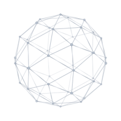

### Linux Systems & Network Engineering

Computer engineering student at Necmettin Erbakan University.

Void Linux, dwm and Neovim are my daily setup. I'm learning C/C++, Linux internals and computer networking.

[LinkedIn](https://www.linkedin.com/in/mert-ari/)
