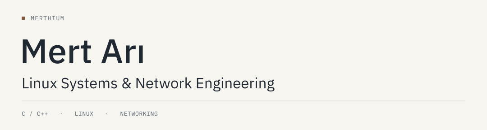

<picture>
  <source media="(prefers-color-scheme: dark)" srcset="assets/header-dark.svg">
  <source media="(prefers-color-scheme: light)" srcset="assets/header-light.svg">
  
</picture>

Computer engineering student at Necmettin Erbakan University, Türkiye.

My main interests are Linux internals and computer networks. I use Void Linux, dwm and Neovim, and work with C/C++ to understand the interfaces between programs and the operating system.

Currently studying POSIX system calls, network fundamentals and data structures.

[LinkedIn](https://www.linkedin.com/in/mert-ari/)
